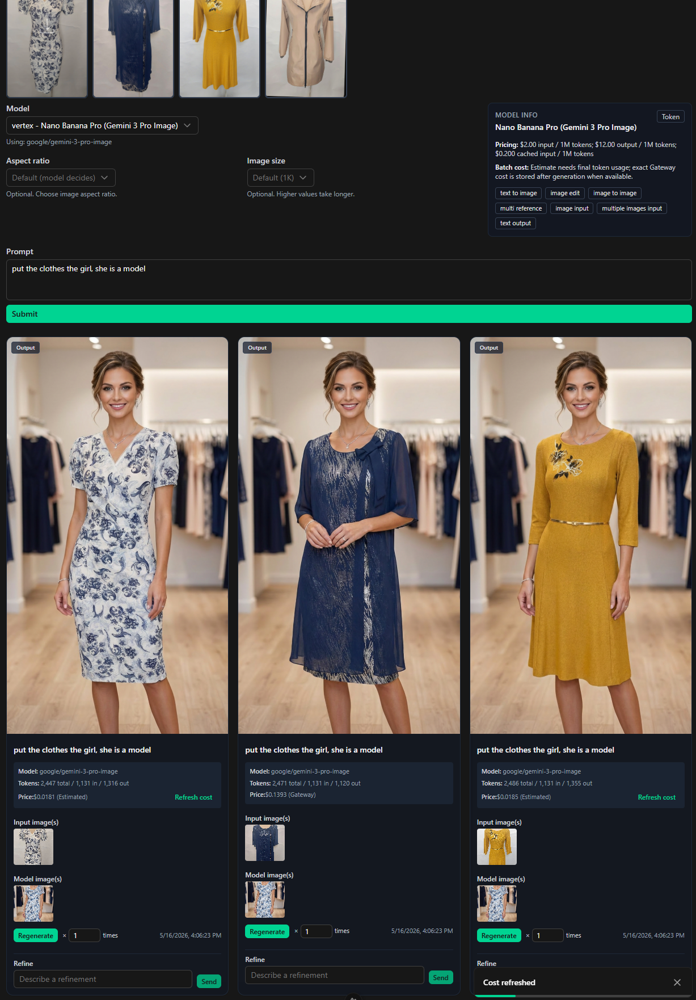

# AI Product Image Generator

Generate product imagery through Vercel AI Gateway, using independent jobs for each selected product image and optional shared reference images or masks.



## Image workspace

The app opens at **Edit** (`/edit`), in a warm studio layout with top navigation and an image-only upload area. Choose one product image from your library or Shared with me to open the canvas, write a prompt, and attach optional shared reference images or a model-specific mask. The canvas supports zoom, download, replacement, and using a generated result as the next input. Model settings remain specific to each current model; favourites, New tags, warnings, reference limits and exact replay are preserved.

**Same-origin batch** (`/same-origin-batch`) applies one prompt and the same shared references to each selected input image. Each input creates an independent generation job; selecting several references does not multiply the jobs. Edit and batch keep separate input selections while sharing the prompt and model settings. Active requests stay visible across workspace navigation, and generation history remains available in both views.

**Library** (`/assets`) provides each user's private images, folders, uploads, keyword search, previews, downloads, favourites and multi-selection. The reusable picker supplies Edit inputs, batch inputs, references and PNG masks. Favourites are browser-local preferences scoped to the organization and user. Listing and search paginate the authorized PostgreSQL asset registry; the browser never scans the bucket or discovers another user's private objects. Generated images are identified by stored metadata; retention eligibility comes from generation records.

**Shared with me** (`/shared`) groups shared files and folders by the person who shared them. A source is a member of the same organization. Shares provide view-only access: previews, downloads and using an image in a new generation; the resulting output belongs to the generating user. The original owner manages the contents and grants or revokes access. Folder grants apply to their logical descendants, including later uploads; revocation applies on the next server operation. Sharing is confined to the same organization. Shared generated images still expire under the retention policy.

Folder badges show the number of visible items directly inside each folder, including child folders. Counts are independent of search and pagination; deleted, expired or unpriced generated images are excluded. Empty folders show `0`. Counts come from one grouped PostgreSQL query for each listing page, with the same organization and sharing checks as the library.

## Organizations and accounts

There are two roles: **organization owner** and **user**. Owners manage accounts in **Team** (`/team`): create usernames and initial passwords, choose roles, update display names, reset passwords, and disable or re-enable accounts. Users manage their own images and sharing, and can change their password in **Account** (`/account`). There is no public signup or email invitation service. The last enabled owner cannot be demoted or disabled.

An owner manages membership but has no automatic access to another user's private images, prompts, billing or Gateway diagnostics. All image reads, upload destinations, sharing, generation inputs, masks, history, details and billing refreshes enforce the authenticated organization and user. Each generation stores trusted ownership; client-supplied IDs cannot select another user's account or history.

After applying the account migration, existing global sessions are invalid and users sign in again. On an empty account database, the first successful sign-in with the configured `NUXT_AUTH_USER` and `NUXT_AUTH_PASSWORD` creates the original organization owner. Existing unclaimed generation history and Gateway logs are assigned to that owner. Once any account exists, environment credentials cannot bypass a changed account password or create another bootstrap owner. Imported image objects require the explicit adoption step below before appearing in a library.

Passwords are individually salted and hashed with bounded asynchronous scrypt. Session cookies contain random opaque tokens; PostgreSQL stores only their hashes, expiry and account version. Sessions expire after 12 hours. Logout revokes the current session; password, role and enabled-state changes revoke the affected user's sessions. Cookies are `HttpOnly`, `SameSite=Lax`, and secure under HTTPS/production. Mutating browser requests require the same origin. Account switches clear in-memory inputs, pending work and private caches; tabs notify each other with an opaque change event so an old tab clears its previous account without revoking a new login.

## Storage and runtime

- Uploaded and generated images are validated raster images in a **private S3-compatible bucket**. Railway Storage Buckets are supported.
- PostgreSQL stores organizations, accounts, hashed sessions, logical assets and sharing grants, generation history, exact replay settings, output dimensions/MIME/bytes, billing, attempt diagnostics, and coordination leases.
- The Nuxt app needs no persistent disk or app volume. Warm instances share PostgreSQL and S3; a fresh instance can serve images and replay stored generations.
- Authenticated image routes proxy private objects through `/api/data/images/...`. Bucket credentials and public/presigned object URLs are never sent to the browser.
- New uploads have immutable UUID object paths under their organization and owner. Logical folders are separate registry metadata: deleting and re-uploading a filename cannot replace an old generation source or revive a revoked file grant. Folder deletion sends a bounded list of exact registered keys, never a recursive physical-prefix delete.
- File listings use bounded cursor pagination bound to the account and filters; the file browser loads more pages on demand. Concurrent uploads use conditional creation and never overwrite existing image bytes.
- Generation admission, running limits, job ownership, and login throttling are coordinated across instances. Provider work is awaited within the request, with abortable timeouts and durable recovery of abandoned pending rows.

This is an image-only application. PDF, video, audio, arbitrary file uploads, and external media URLs are unsupported. All AI requests use the Vercel AI SDK through Vercel AI Gateway.

## Requirements and configuration

Use Node.js 26.x, PostgreSQL, a private S3-compatible bucket, and a Vercel AI Gateway key. Copy `.env.example` to an ignored `.env` and fill in the server credentials:

```env
NUXT_AI_GATEWAY_API_KEY=
NUXT_AUTH_USER=
NUXT_AUTH_PASSWORD=
DATABASE_URL=postgresql://localhost:5432/autoproductimagery
DATABASE_POOL_MAX=3
S3_ENDPOINT=https://t3.storageapi.dev
S3_REGION=auto
S3_BUCKET=
S3_ACCESS_KEY_ID=
S3_SECRET_ACCESS_KEY=
S3_PREFIX=images
S3_FORCE_PATH_STYLE=false
```

Set strong initial owner credentials and keep them consistent across instances until the original owner has signed in. Subsequent authentication uses account password hashes and revocable sessions in PostgreSQL. The legacy `NUXT_AUTH_SESSION_SECRET` setting is no longer used by the account-session implementation and does not need to be rotated or changed for this upgrade.

Railway buckets use virtual-host addressing, so `S3_FORCE_PATH_STYLE=false` is appropriate for Railway. Use the bucket's **base endpoint** and its S3 bucket name from the Credentials tab. The bucket's display name and S3 bucket name can differ. Other S3 services may require path addressing. Objects remain under `S3_PREFIX`; do not point unrelated applications at the same prefix.

Inside Railway, reference the bucket and database variables on the app service instead of copying credentials. For resources named `images-dev` and `Postgres`:

```text
DATABASE_URL=${{Postgres.DATABASE_URL}}
S3_ENDPOINT=${{images-dev.ENDPOINT}}
S3_BUCKET=${{images-dev.BUCKET}}
S3_REGION=${{images-dev.REGION}}
S3_ACCESS_KEY_ID=${{images-dev.ACCESS_KEY_ID}}
S3_SECRET_ACCESS_KEY=${{images-dev.SECRET_ACCESS_KEY}}
```

The app uses a small PostgreSQL connection pool (`DATABASE_POOL_MAX`, default 3, maximum 10) with bounded connection/query/idle timeouts. For many function instances, use a compatible database connection pooler and account for total instance connections. Outside Railway's private network, use a TLS connection URL with certificate verification or set `DATABASE_SSL=true` and, if needed, `DATABASE_CA_CERT` to a trusted PEM certificate (`\n` escapes are accepted). The runtime rejects `sslmode=no-verify` and never disables certificate verification. Railway's private network URL does not need a public TCP proxy.

## Development and verification

```sh
npm ci
npm run drizzle:migrate
npm run dev
```

Migrations require an explicitly configured PostgreSQL `DATABASE_URL`; SQLite URLs are rejected. Run migrations once against the intended development database before starting the app. They never run on app cold starts.

```sh
npm test
npx nuxi typecheck
npm run build
npx drizzle-kit check
git diff --check
```

Set `TEST_DATABASE_URL` and `PG_TEST_DATABASE_URL` to a **disposable PostgreSQL database** to run the database and cross-instance integration tests as well. Those tests create isolated schemas and fake provider transports; they do not make paid image-generation calls.

## Serverless deployment

Railway's sleeping/serverless app mode is supported: the app uses shared S3/PostgreSQL state and does not mount an image or SQLite volume. Build from the repository root with `npm run build`, then start with `node .output/server/index.mjs`. Apply migrations as a separate, explicit deployment step, rather than from the start command or every incoming request.

Keep `railpack.json`: Node 26 requires `libatomic1` in both the build and final runtime image. It uses explicit Apt package names compatible with Railpack 0.23.0. Verify the final runtime as well as the build.

The default provider timeout is 180 seconds. `NUXT_IMAGE_GENERATION_REQUEST_TIMEOUT_MS` defaults to 270 seconds and limits queue waits and provider work. Already-returned provider outputs are still persisted through bounded S3/database operations before the handler returns. Set the host's maximum request duration above the provider-work budget **plus the output-persistence margin**, or lower the configured budget and batch size. This requires a Node serverless runtime with enough execution time for image generation; edge-only runtimes and short-duration functions are unsupported.

Expired worker leases permit conservative pending-job recovery on subsequent requests. A paid call that fails or exceeds its deadline is recorded as retryable when appropriate; completed siblings remain successful. A hard process kill between an S3 write and database persistence can leave an orphan object for later operational cleanup.

## Production deployments from master

The single Railway `production` environment runs the app, PostgreSQL, private image bucket and daily retention worker. Configure both the `app` and `image-retention` services with the GitHub source `Codethier/autoproductimagery`, branch `master`, automatic push deployments and **Wait for CI** disabled. GitHub Actions CI is not configured for this repository. Run the local verification commands above before publishing an approved change.

| Service | Build | Start | Pre-deploy |
| --- | --- | --- | --- |
| `app` | `npm run build` | `node .output/server/index.mjs` | `npm run drizzle:migrate` |
| `image-retention` | `npm run build:retention` | `node .output/cleanup-generated-images.mjs --apply` | None; app applies reviewed migrations |

The app uses the `/api/health` readiness check and Railway serverless/sleep mode. The retention service has the daily schedule documented below and no public domain. PostgreSQL and S3 remain private; their connection variables are Railway service references. Pushes deploy the committed repository snapshot directly, so local ignored credentials and datasets are never part of the GitHub deployment source.

Before switching an existing installation, review every deployment target watching `master`. Disable any obsolete target's automatic deployment before pushing this PostgreSQL/S3 version if that target still uses the previous SQLite/filesystem configuration. Preserve its existing application and stored data until a separate cutover is authorized. Production environment changes and migrations still require the explicit confirmation in `AGENTS.md`.

## User credit and confirmed image prices

Each account has **available credit**, **confirmed spending**, and **outstanding charges** in USD. Credit defaults to **Unlimited**. Organization owners can open **Team → Balance** to set a user's available credit, or restore Unlimited; changes are audited and limited to the owner's organization. This is an internal credit ledger, with no payment collection or checkout integration.

Confirmed charges reduce finite credit once, transactionally. Outstanding estimated amounts are labeled separately, and charges without an amount have an unknown count; an unknown cost is never treated as zero. Finite accounts can run one unresolved batch at a time. Because the catalog estimate cannot guarantee the final price, that batch may take the remaining credit below zero; the next batch is blocked until the owner adds credit. Existing historical confirmed spending appears in totals without reducing newly assigned credit again.

Generated images stay unavailable until the final Gateway generation record confirms the exact charge. Result cards appear only once that price is confirmed; previews, downloads, Assets, shared folders, favorites and generation references all enforce the same server check. A confirmed zero-cost result is valid. Each revealed result shows its confirmed price without rounding small positive costs to zero. Uploaded images remain usable immediately.

History and balance reads reconcile a small number of provider calls, with PostgreSQL leases, retry backoff and bounded network timeouts. The client refreshes automatically while results await pricing; no manual price-check controls are shown. Multi-output calls share the provider total exactly, including charged outputs whose storage failed. Repeated refreshes cannot charge a user again or overwrite a confirmed price with an estimate. Prompts, prices and account charges remain after image retention deletes the bytes.

Only ordinary Gateway-funded prices can be fully confirmed. BYOK generation records remain held because Gateway's charge excludes the external provider invoice, and its upstream cost is a market estimate. See the [Vercel generation lookup reference](https://vercel.com/docs/ai-gateway/sdks-and-apis/rest-api#look-up-a-generation).

## Image previews and private caching

Library grids and image strips request bounded WebP previews (160 or 480 pixels); the editor and larger previews request up to 1600 pixels. Resize fits the image inside the requested square, preserves its proportions and transparency, applies orientation, and never upscales. Downloads and generation inputs always use the original validated bytes.

The authenticated image endpoint supports only fixed `preview=160`, `480`, `960`, or `1600` presets; omitting the query returns the original. Successful responses use `Cache-Control: private, no-cache, must-revalidate`, `Vary: Cookie` and account/representation-scoped ETags. Browsers may retain the image and revalidate it with a bodyless `304`. Session, organization, sharing, deletion and confirmed-price checks run before every cache hit or `304`; errors use `no-store`. Images are never made public through a CDN or image optimizer.

Each warm server instance retains at most 64 MiB of image bytes: 48 MiB of fully validated originals and 16 MiB of previews, with LRU eviction and a five-minute absolute lifetime. Identical concurrent reads coalesce. Original reads and preview transforms each have two active slots and a bounded queue; overload returns a retryable `429`. A serverless cold start begins with an empty memory cache. Full validation still runs when an original enters the cache, so corrupt images never become cached previews. The cache requires no disk, persistent app volume, database migration or new service variables.

## Generated image retention

Set `GENERATED_IMAGE_RETENTION_DAYS` on the cleanup service to choose how long generated images are retained. The default is **180 days**. Use a whole number from 1 to 36500, or `0` to disable cleanup. Invalid or blank values fail without deleting anything. Changing the number applies to existing generated outputs on the next run: lowering it can make older images immediately eligible.

Cleanup selects successful generation records older than the cutoff and deletes their exact, recognized S3 output objects. It does not expire uploaded product/reference/mask images, delete folders, or erase prompts, settings, billing, or Gateway logs. Age uses the generation's original `createdAt`, so refreshing billing does not extend retention. History shows **Image expired** after deletion. You can still regenerate from available original uploads; refinement or exact replay that needs an expired generated image reports why it is unavailable.

Only the application's immutable UUID output names are managed automatically. Imported legacy names that cannot be verified as managed outputs are preserved. An output shared by an unexpired generation record is also preserved. Untracked orphan objects are outside this cleanup's scope.

Build and preview a cleanup using the target database's environment variables:

```sh
npm run images:cleanup
npm run images:cleanup -- --apply
```

The default command is a dry run and needs no S3 credentials. `--apply` deletes eligible objects. Use an explicitly configured target database and bucket; the worker never runs migrations itself. Successful deletions get an `outputImageDeletedAt` marker while retaining the original URL as historical metadata. Failed deletions remain eligible for retry; deleting an already-missing object is safe to retry. PostgreSQL prevents overlapping workers, and each run has bounded SQL pages, a 10000-row limit and a five-minute work budget.

On Railway, use a **separate cron service** named `image-retention` alongside the sleeping web app. Configure:

| Setting | Value |
| --- | --- |
| Build command | `npm run build:retention` |
| Start command | `node .output/cleanup-generated-images.mjs --apply` |
| Cron schedule | `0 3 * * *` (daily at 03:00 UTC) |
| Restart policy | `NEVER` |
| Database pool | `DATABASE_POOL_MAX=1` |
| Retention | `GENERATED_IMAGE_RETENTION_DAYS=180` |
| Network | No public domain or TCP proxy |

Reference the same PostgreSQL and private S3 variables as the app, including its storage prefix. The worker needs no Gateway key or login credentials. Apply reviewed database migrations through the app's explicit pre-deploy step before deploying the worker. It closes PostgreSQL and S3 connections when done, so it consumes no continuously running app process. Railway schedules are in UTC and may start a few minutes after the scheduled time. See [Railway cron documentation](https://docs.railway.com/cron-jobs).

## Migrations and existing local data

Drizzle ORM and Kit stay pinned to `1.0.0-rc.4`. The PostgreSQL schema lives in `server/db/schema.ts`; its generated SQL and snapshots live in `drizzle/postgres/`. The earlier SQLite migration folders under `drizzle/` are retained intact as historical archives, and are not applied to PostgreSQL.

Change the schema, then generate and review migrations:

```sh
npm run drizzle:generate -- --name=describe_the_change
npx drizzle-kit check
npm run drizzle:migrate
```

Never hand-edit generated SQL/snapshots or use `drizzle-kit push`. Test a migration on a disposable database before applying it to the intended environment. `drizzle:up` is an explicit migration-format upgrade tool, not a startup command.

Existing local images and SQLite databases are preserved by this refactor. The explicit import tools support moving them to a development target while keeping historical `/images/...` paths and stored replay settings. Review their dry-run reports first; they do not run automatically. Production migration/import/deployment requires separate authorization and confirmation of the exact action.

Read-only inventory and validation:

```sh
node --import ./tests/register-typescript.mjs scripts/import-local-images.ts --source ./data/images --dry-run
node --import ./tests/register-typescript.mjs scripts/import-sqlite-to-postgres.ts --sqlite=./sqlite/drizzle.db --dry-run
```

To apply to an empty development target, first configure the development bucket credentials, set `APP_ENV=development`, and run the image importer with `--confirm-development` instead of `--dry-run`. Then set `IMPORT_DATABASE_URL` explicitly and run the database importer with `--apply --environment=development`. The image importer preserves paths, validates content, resumes identical existing objects, and refuses conflicting overwrites. The database importer preserves IDs, JSON, timestamps, billing, and log relationships transactionally, and refuses a populated generation/history target. Complete imports before the first owner sign-in so bootstrap can assign the unclaimed history.

After the original owner is initialized, review a bounded plan for registering imported legacy image objects in that owner's library:

```sh
node --import ./tests/register-typescript.mjs scripts/adopt-legacy-assets.ts --organization-id <uuid> --owner-id <uuid> --max-entries 1000
```

To apply the reviewed plan, add `--apply --confirm-owner-id <same-owner-uuid>`. The command is restricted to the original bootstrap owner, validates every newly registered image, preserves existing URLs and ownership, and writes metadata only. It never modifies S3 bytes. Objects in the new organizations namespace and deleted registry entries cannot be adopted as legacy files. The default limit is 1000 entries, with an upper bound of 10000; folders are bounded to 32 levels. Legacy objects remain inaccessible through application routes until explicitly registered. Adoption against production requires separate exact confirmation.

The local `private-agents.md` stores the selected Railway project/development IDs and is ignored. Real `.env` files, databases, and `.codex/artifacts/` reports are also ignored; `.env.example` contains no credentials.
