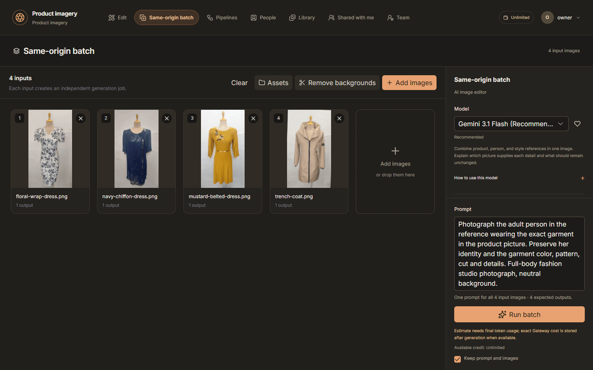
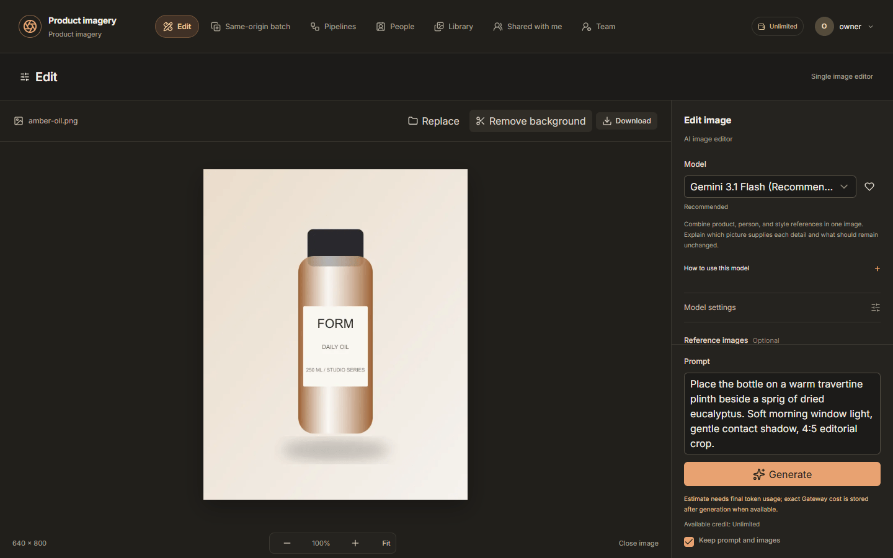
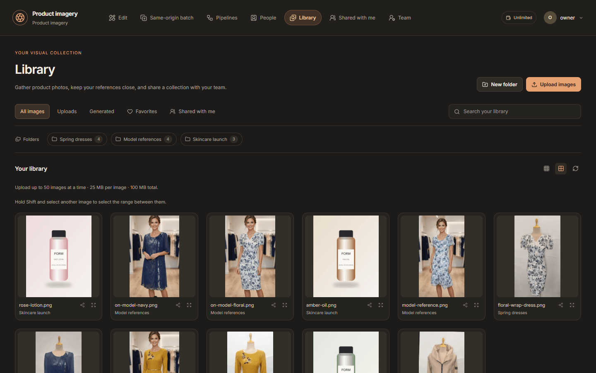
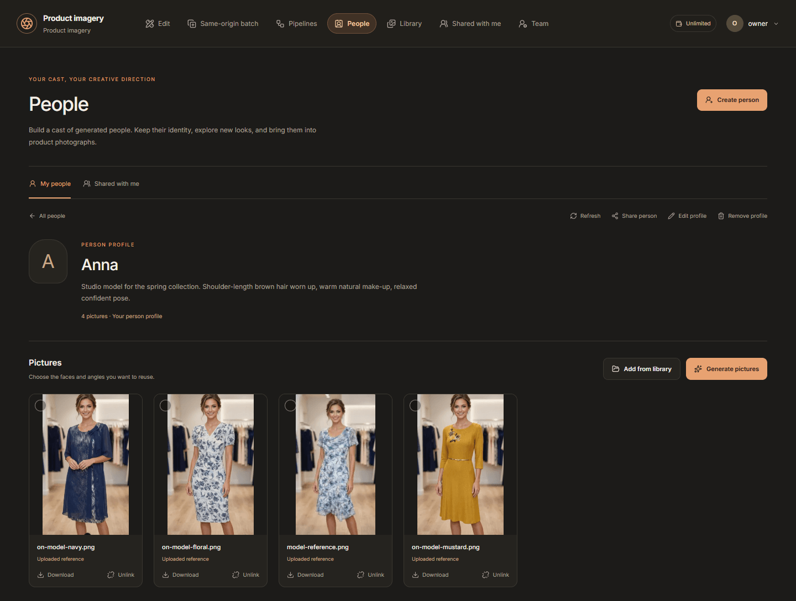
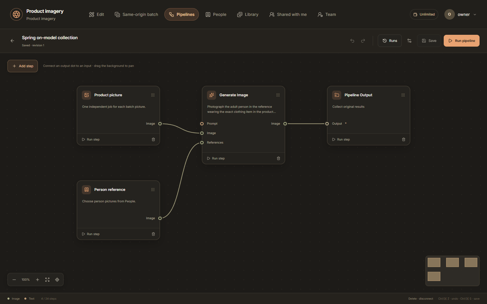
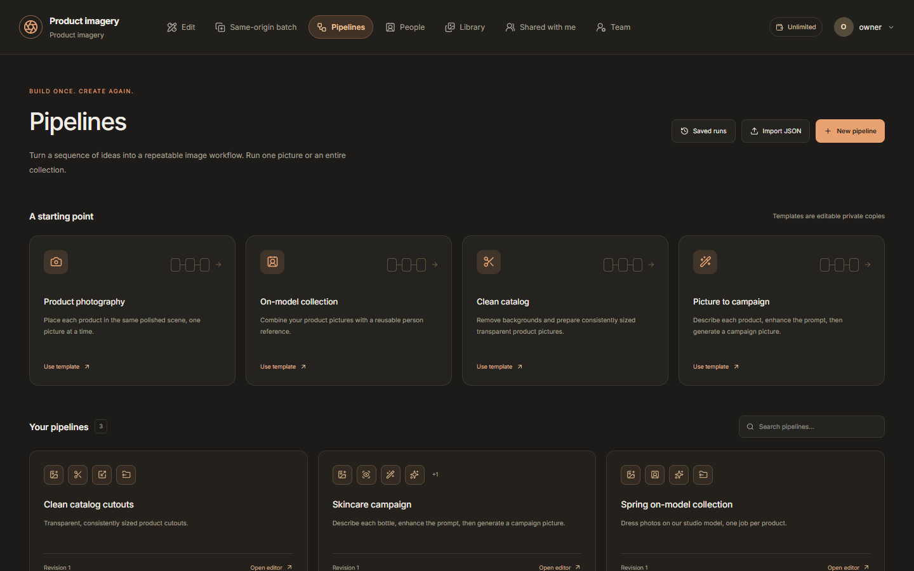
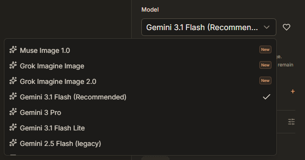
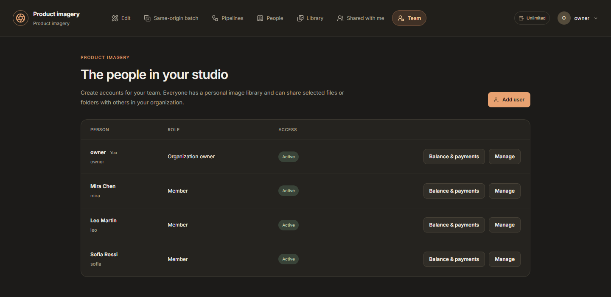
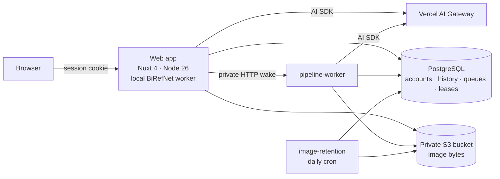

<div align="center">

# AI Product Image Generator

**Turn plain product photos into polished, on-model imagery: one independent job per product, reusable people, and durable multi-step pipelines, powered by Vercel AI Gateway.**

[](LICENSE)


[Workspaces](#workspaces) · [Pipelines](#pipelines) · [Quick start](#quick-start) · [Configuration](#configuration) · [Deployment](#deployment) · [Model catalog](docs/image-model-catalog.md)

<br>



<sub>Same-origin batch: one prompt for four product photos, each run as its own generation job.</sub>

<br><br>


<sub>Example results: mannequin shots turned into on-model photos with Gemini 3 Pro Image.</sub>

</div>

## Highlights

- **One job per product.** Every selected product image becomes its own generation job. Shared references attach to each job without multiplying them.
- **Controls that fit the model.** Each model has its own sizes, aspect ratios, reference limits, masks, warnings and *How to use this model* guidance.
- **Pipelines.** A visual node editor for multi-step image and text workflows. Runs are durable and keep going after the browser closes.
- **People.** Reusable, shareable person profiles that act as identity references across Edit, batch and pipelines.
- **Organizations and credit.** Owners manage accounts, credit and recorded payments. Generated images appear only once their exact price is confirmed.
- **Local background removal.** BiRefNet runs on the app server's CPU with a known $0 provider charge.
- **Private and serverless.** Images live in a private S3 bucket behind authenticated routes, and the app, pipeline worker and database can all sleep when idle.

<details>
<summary><b>Table of contents</b></summary>

- [Workspaces](#workspaces)
  - [Edit and Same-origin batch](#edit-and-same-origin-batch)
  - [Library and sharing](#library-and-sharing)
  - [People](#people)
- [Pipelines](#pipelines)
- [Supported models](#supported-models)
- [Organizations and accounts](#organizations-and-accounts)
- [Credit and confirmed prices](#credit-and-confirmed-prices)
- [Background removal](#background-removal)
- [Architecture](#architecture)
- [Quick start](#quick-start)
- [Configuration](#configuration)
- [Testing](#testing)
- [Deployment](#deployment)
- [Generated image retention](#generated-image-retention)
- [Database migrations](#database-migrations)
- [Project layout](#project-layout)

</details>

## Workspaces

| Workspace | Route | What it's for |
| --- | --- | --- |
| **Edit** | `/edit` | Work on one product image on a canvas. The app opens here. |
| **Same-origin batch** | `/same-origin-batch` | One prompt and the same references applied to up to 50 product images. |
| **Pipelines** | `/pipelines` | Build and run multi-step image and text workflows. |
| **People** | `/people` | Private person profiles used as identity references. |
| **Library** | `/assets` | Your private images, folders and uploads. |
| **Shared with me** | `/shared` | Files, folders and people that members of your organization shared with you. |
| **Team** | `/team` | Accounts, roles, credit and payments (organization owners only). |
| **Account** | `/account` | Your password, balance and payment history. |

### Edit and Same-origin batch



**Edit** uses a warm studio layout with top navigation and an image-only upload area. Choose one product image from your Library or Shared with me to open the canvas, write a prompt, and attach optional shared reference images or a model-specific mask. The canvas supports zoom, download, replacement, and using a generated result as the next input. Model settings stay specific to the selected model; favourites, **New** tags, warnings, reference limits and exact replay are preserved.

**Same-origin batch** applies one prompt and the same shared references to each selected input image. Each input creates an independent generation job; selecting several references does not multiply the jobs. Edit and batch keep separate input selections but share the prompt and model settings. Active requests stay visible as you move between workspaces, and generation history is available in both views.

### Library and sharing



**Library** holds each user's private images, folders, uploads, keyword search, previews, downloads, favourites and multi-selection. Its reusable picker supplies Edit inputs, batch inputs, references and PNG masks.

- Favourites are browser-local preferences scoped to the organization and user.
- Listing and search paginate the authorized PostgreSQL asset registry. The browser never scans the bucket or discovers another user's private objects.
- Generated images are identified by stored metadata, and retention eligibility comes from generation records.
- Folder badges count the visible items directly inside each folder, including child folders. Counts ignore search and pagination and exclude deleted, expired or unpriced generated images; empty folders show `0`. Each listing page uses one grouped PostgreSQL query with the same organization and sharing checks as the Library.

> [!TIP]
> In image pickers, click a picture and **Shift-click** another to select the visible range between them. Selections from other folders or People profiles stay selected. Each picker keeps its own model/reference limit, and changing accounts, filters or profiles resets the range anchor.

**Shared with me** groups shared files and folders by the member who shared them. Sharing is confined to the same organization and is view-only: previews, downloads and using an image in a new generation, whose output belongs to the generating user. The original owner manages the contents and grants or revokes access. Folder grants cover their logical descendants, including later uploads, and revocation applies on the next server operation. Shared generated images still expire under the [retention policy](#generated-image-retention).

### People



**People** keeps named person profiles with descriptions and multiple photos, private by default. Create a profile, generate its first photos from a description, or attach images you own from Library. Select existing photos as identity references to generate more views of the same person.

- The generator uses the current model selector and model-specific settings through Vercel AI Gateway, with the same credit accounting and exact-price confirmation as Edit. A generated photo appears only after its final price is confirmed.
- Descriptions and reference photos guide consistency, but a model may still vary the person's appearance between generations.
- Choose **People** under Reference images in Edit or Same-origin batch to select individual photos. In batch, the same person references accompany every product input, and the model's reference limit applies to the full selection.
- Removing a photo from a profile, or deleting a profile, preserves the underlying images and generation history in Library. Retention still applies to generated person photos; a profile does not extend their lifetime.

**Share person** gives selected members of the same organization view-only access to a profile and its photos. Recipients find it in People's **Shared with me** view or under **Shared with me → People**, grouped by sharer. They can download photos or use them as references for their own generations, but cannot edit the profile, change its pictures, reshare it, or add generated pictures to it. Future confirmed pictures follow the grant automatically. Revoking the grant, unlinking a photo, removing the profile or disabling its owner withdraws profile-derived access; a separate file or folder share remains independent. Images stay private in S3 and pass the usual authorization and final-price checks on every read.

## Pipelines



Open **Pipelines**, start from a template or a blank workflow, and add steps from the node palette.

<details>
<summary><b>Templates and saved pipelines</b></summary>

<br>



</details>


- **Connect** matching image or text ports by clicking an output and then an input, or use the connection selector in the properties panel. Choosing the same source and target ports again removes that connection.
- **Move** nodes by dragging their header or with the arrow keys. Pan, zoom, fit, the overview, undo/redo, and copy/duplicate/delete all work on the saved graph.
- **Delete** on a selected node disconnects all of its connections but keeps its settings and position; on a selected connection it removes only that connection. The trash button deletes the node.
- **Saving** uses a revision check, so conflicting edits require reloading the saved version. JSON export/import contains the private graph and image paths, without credentials or image bytes.

| Category | Steps |
| --- | --- |
| Inputs | Image Input, People Input, Text Input, Static Image, Static Text |
| Image | Generate Image, Remove Background, Crop, Resize, Upscale, Expand, Translate |
| Text | Describe Image, Prompt Enhancer, LLM, Prompt Concatenator |
| Output and notes | Pipeline Output, Sticky Note |

Generation, AI upscaling, expansion and image translation use the existing exact image-model profiles and their own settings. Standard 2×/4× upscaling uses Lanczos resampling on the CPU, as do Crop and Resize. Describe Image and LLM keep the explicit `google/gemini-2.5-flash` Gateway text model, whose multimodal input and text output are documented by [Google](https://ai.google.dev/gemini-api/docs/models/gemini-2.5-flash) and [Vercel](https://vercel.com/ai-gateway/models/gemini-2.5-flash/about). No direct provider SDKs are used.

**Prompt Enhancer** offers GLM 5.3 Flash, GPT-6 Luna and the existing Gemini 2.5 Flash profile. Its **Reasoning effort (attention level)** control shows only the selected model's verified levels, and changing models resets incompatible settings while keeping the instructions. Luna exposes temperature only with effort set to None. Thinking and the final text share the output-token cap, and text is held until Gateway confirms its exact charge. Saved runs retain their exact model, effort and settings. See the [utility-model integration notes](docs/pipeline-text-models.md) for supported options and sources.

**People Input** opens the People picker, where you can choose up to 16 exact pictures from your own or shared profiles. Connect its image output to **Generate Image → References** to reuse those pictures for every product in a batch; each model's smaller reference limit still applies. The chosen pictures stay fixed for the run, so adding a photo to a profile does not change an existing run. If a photo is unlinked, deleted or no longer shared with you, later steps cannot reuse it and it disappears from pipeline and run previews. The On-model collection template includes this input.

### Running a pipeline

**Run pipeline** asks for the batch image-input node and up to 50 product pictures. Other image inputs, People references and text inputs are shared values for the run, and each batch picture gets its own progress and results. Only ancestors of Pipeline Output nodes run; **Run step** executes just the chosen node and its ancestors.

| Limit | Value |
| --- | --- |
| Nodes per graph | 24 |
| Connections per graph | 80 |
| Image values per step | 50 |
| Planned paid calls per run | 500 |
| Product pictures per run | 50 |

Invalid graphs and excessive fan-out are rejected before any paid work. Cycles, video/audio, public media URLs and executable code are out of scope.

- **Durable runs.** Runs continue after the browser closes, and the saved graph and input snapshot stay fixed even if the pipeline is edited later.
- **Confirmed costs.** Completed intermediates feed later steps only after their exact Gateway costs are confirmed. Finite credit is checked before every new paid wave; local processing has a known $0 provider charge.
- **Real dimensions.** Results show the actual returned dimensions, because AI models do not guarantee exact canvas margins or upscale sizes.
- **Cancellation** prevents later work and preserves accepted calls and charges.
- **Retry.** An interrupted paid call is never repeated automatically. The explicit retry dialog warns that a new call can incur another charge and may repeat earlier successful variants of that node. Images and earlier charged attempts remain recorded.
- **Rerun job.** Each completed input job has **Rerun job** in its results pane. It requeues every step for that input using the run's saved graph, original inputs, models, settings and target, even if the editor has changed since. Other jobs keep their claims and results. New outputs replace the latest displayed attempt, while earlier assets and charges stay recorded. Repeating paid steps incurs new charges and needs fresh credit and source-permission checks. The five-attempt limit applies to each step across retries and reruns; start a new run for more variations. Unfinished or unpriced jobs cannot be rerun, and failed or interrupted steps keep the separate Retry flow.
- **Display order.** Step lists, input selectors, result columns, expanded details and retry choices follow the saved canvas left to right, then top to bottom for equal horizontal positions, keeping original order for ties. This never changes dependency-based execution or the workflow snapshot.
- **Download all** streams confirmed final images as a ZIP with each file's original bytes. It rechecks access for every picture and caps an archive at 200 files and 256 MiB; larger runs keep individual downloads. Local pipeline outputs and prepared expansion canvases/masks expire through the daily processed-image policy, while uploaded sources, workflow definitions, prompts and charges are preserved.

## Supported models

Curated, exact-ID profiles from **Google** (Gemini image), **OpenAI** (GPT Image), **Black Forest Labs** (FLUX.2, FLUX Kontext, FLUX Pro), **ByteDance** (Seedream), **Meta** (Muse) and **xAI** (Grok Imagine). A model is listed only when it accepts a text prompt **and** uploaded images, and returns a raster image through Vercel AI Gateway. The [image model catalog](docs/image-model-catalog.md) lists every model ID, reference limit and settings route, and the reason for each exclusion.



Image model panels in Edit, Same-origin batch, People and Pipelines include **How to use this model** guidance covering this app's source and mask file requirements and each model's reference limits. Mask conventions differ by model:

| Model family | Mask convention |
| --- | --- |
| OpenAI edits | Transparent areas guide changes; opaque areas are preserved. |
| FLUX Fill | White replaces; black preserves. |

Input masks and transparent output are separate settings.

> [!NOTE]
> This is an image-only application. PDF, video, audio, arbitrary file uploads and external media URLs are not supported. Generative AI requests go through the Vercel AI SDK and Vercel AI Gateway; background removal uses the local CPU processors described [below](#background-removal).

## Organizations and accounts



| Role | Can |
| --- | --- |
| **Organization owner** | Create usernames and initial passwords, choose roles, update display names, reset passwords, disable or re-enable accounts, and manage credit and payments in **Team**. |
| **User** | Manage their own images and sharing, and change their password in **Account**. |

There is no public signup or email invitation service, and the last enabled owner cannot be demoted or disabled. An owner manages membership but has no automatic access to another user's private images, prompts, billing or Gateway diagnostics. All image reads, upload destinations, sharing, generation inputs, masks, history, details and billing refreshes enforce the authenticated organization and user. Each generation stores trusted ownership, so client-supplied IDs cannot select another user's account or history.

**Bootstrapping.** On an empty account database, the first successful sign-in with the configured `NUXT_AUTH_USER` and `NUXT_AUTH_PASSWORD` creates the original organization owner, and existing unclaimed generation history and Gateway logs are assigned to that owner. Once any account exists, environment credentials cannot bypass a changed password or create another bootstrap owner. Imported image objects need the explicit [adoption step](#importing-existing-local-data) before they appear in a library.

> [!IMPORTANT]
> Applying the account migration invalidates existing global sessions, so every user signs in again.

**Sessions and security**

- Passwords are individually salted and hashed with bounded asynchronous scrypt.
- Session cookies hold random opaque tokens. PostgreSQL stores only their hashes, expiry and account version, and sessions expire after 12 hours.
- Logout revokes the current session. Password, role and enabled-state changes revoke the affected user's sessions.
- Cookies are `HttpOnly`, `SameSite=Lax`, and `Secure` under HTTPS/production. Mutating browser requests must come from the same origin.
- Switching accounts clears in-memory inputs, pending work and private caches. Tabs notify each other with an opaque change event, so an old tab clears its previous account without revoking a new login.

## Credit and confirmed prices

Each account has **available credit**, **confirmed spending** and **outstanding charges** in USD. Credit defaults to **Unlimited**. Owners can set a user's available credit, or restore Unlimited, in **Team → Balance & payments**; changes are audited and limited to the owner's organization. This is an internal credit ledger, with no payment collection or checkout integration.

- **Charging.** Confirmed charges reduce finite credit once, transactionally. Outstanding estimates are labelled separately, and charges without an amount are counted as unknown; an unknown cost is never treated as zero. Historical confirmed spending appears in totals without reducing newly assigned credit again.
- **Finite credit.** A finite account can run one unresolved batch at a time. Because the catalog estimate cannot guarantee the final price, that batch may take the remaining credit below zero, and the next batch is blocked until the owner adds credit.
- **Out of credit.** At zero or negative available credit, a new paid generation opens **More balance needed** instead of submitting provider work, pointing the user to their organization owner and to Account. This covers Edit, Same-origin batch, People, regenerate/refine, and new paid pipeline runs or retries. Balances refresh before submission, and the server rejects exhausted credit even when the browser's balance is stale. Unlimited accounts and known-free local processing stay available, and already accepted work and its charges are preserved.

### Exact-price gate

Generated images stay unavailable until the final Gateway generation record confirms the exact charge. Result cards appear only once that price is confirmed, and previews, downloads, Library, shared folders, favorites and generation references all enforce the same server check. A confirmed zero-cost result is valid. Each revealed result shows its confirmed price, without rounding small positive costs to zero. Uploaded images are usable immediately.

History and balance reads reconcile a small number of provider calls at a time, with PostgreSQL leases, retry backoff and bounded network timeouts. The client refreshes automatically while results await pricing, so there are no manual price-check controls. Multi-output calls split the provider total exactly, including charged outputs whose storage failed. Repeated refreshes cannot charge a user again or overwrite a confirmed price with an estimate. Prompts, prices and account charges remain after retention deletes the image bytes.

> [!NOTE]
> Only ordinary Gateway-funded prices can be fully confirmed. BYOK generation records stay held, because Gateway's charge excludes the external provider invoice and its upstream cost is a market estimate. See the [Vercel generation lookup reference](https://vercel.com/docs/ai-gateway/sdks-and-apis/rest-api#look-up-a-generation).

### Recorded payments

For an Unlimited user, an owner can record a received USD payment in **Team → Balance & payments**. Each immutable entry has a positive amount in cents, an optional note, the recording owner's identity and a server timestamp. This is bookkeeping only: it does not transfer money, alter generation prices or top up available credit. Users see their own payment history on **Account**, and owners can list histories within their organization.

| Balance field | Meaning |
| --- | --- |
| **Total paid** | Sum of recorded payments. |
| **Unpaid bills** | Confirmed spending minus recorded payments, never below zero. |
| **Paid ahead** | Shown when payments exceed confirmed spending. |

Unpriced and estimated charges stay separate. For example, a $10 confirmed bill with a $5 payment shows $5 paid and $5 unpaid while the account remains Unlimited. Payments stay visible if the owner later switches the account to finite credit, but new entries require Unlimited credit. Duplicate submissions safely replay the original receipt through a request key, and a failed response can retry the same payment. Entries are read-only; there are no edit or delete endpoints.

## Background removal

Choose **Remove background** in Edit or in an image preview in Library. Batch inputs and selected Library images allow up to five source images per submission. Each source becomes an independent durable job, and its transparent PNG is saved to the requesting user's **Cutouts** folder with the original unchanged. Shared images can be processed while their view grant is valid; the new cutout belongs to the processing user.

Both processors use pinned MIT-licensed [BiRefNet models](https://github.com/ZhengPeng7/BiRefNet) exported by [rembg](https://github.com/danielgatis/rembg), running on ONNX Runtime's CPU backend in a separate Node process inside the existing app container. No extra Railway service, GPU, Python runtime, public model endpoint or provider API key is needed. Jobs have a known **$0 provider charge** and do not debit user credit, although server CPU and RAM still cost hosting.

| | BiRefNet Lite (default) | BiRefNet (Full) |
| --- | --- | --- |
| ONNX export size | ~214 MiB | ~928 MiB |
| Free memory required to start | 8 GiB | 10 GiB |
| Cold / warm run* | ~19 s / ~12 s | ~39 s / ~25 s |
| Peak memory* | 7.34 GB | 8.83 GB |
| Idle RSS after use* | ~0.75 GB | ~1.95 GB |

<sub>* Development measurements on Linux Node 26.10 with two CPU cores and a 640×800 product fixture, not production latency guarantees. Both use a fixed 1024×1024 inference tensor.</sub>

> [!IMPORTANT]
> Allow roughly **12–16 GB of total app memory** for these CPU exports and the web server; small 2–4 GB VMs are not enough. Before creating a worker, the engine checks available process/cgroup memory, and insufficient memory produces a clear job error without loading the model.

<details>
<summary><b>Queueing, recovery and build details</b></summary>

<br>

**Queue.** PostgreSQL admits at most 20 waiting jobs globally and five outstanding jobs per user, with one running inference across app instances. A 90-second lease is renewed during work; only expired leases can recover, and jobs get at most two attempts. Processing has a ten-minute engine deadline, and shutdown or abort terminates the worker process. Source authorization is repeated before inference and before publication. A cutout becomes visible only after its asset and successful job transition commit together, and a failed publication removes that exact staged S3 object.

**On-demand worker.** Enqueue and status requests and app startup wake the durable queue; there is no idle PostgreSQL poller keeping Railway awake. A job continues when its dialog closes. After a hard container restart, a live old lease must expire before recovery, and an authenticated status request can resume it. The selected model stays loaded for reuse and is released after 60 idle seconds, when the idle process exits to release native memory. This needs a persistent Node container with process support, such as Railway's sleeping app mode; request-lifetime-only functions and edge runtimes cannot run it.

**Memory tuning.** Keep native memory arenas and memory-pattern caching disabled: tests with them enabled retained substantially more RAM.

**Build.** `npm run build` packages the worker, native CPU runtime and both model files into the deployable app image. Downloads use the fixed URLs, exact byte sizes and SHA-256 hashes in `schemas/background-removal-models.ts`, and a missing or mismatched artifact fails the build. Model files are build artifacts outside the public directory, never committed to Git or stored as user images. Run `npm run build:background-removal` to prepare them before `npm run dev`. Git pushes rebuild the worker with the app, so no separate deployment step is needed.

**Startup check.** A separate bounded startup check loads the packaged CPU libraries in the final runtime and verifies Linux Node shared libraries, including `libatomic`, without running inference.

</details>

## Architecture



- **Images.** Uploaded and generated images are validated raster images in a private S3-compatible bucket; Railway Storage Buckets are supported. Authenticated routes proxy private objects through `/api/data/images/...`, and bucket credentials and public or presigned object URLs never reach the browser.
- **Data.** PostgreSQL stores organizations, accounts, hashed sessions, logical assets and sharing grants, generation history, exact replay settings, output dimensions/MIME type/bytes, billing, attempt diagnostics and coordination leases.
- **No persistent disk.** Warm instances share PostgreSQL and S3, and a fresh instance can serve images and replay stored generations.
- **Immutable uploads.** New uploads get immutable UUID object paths under their organization and owner. Logical folders are separate registry metadata, so deleting and re-uploading a filename cannot replace an old generation source or revive a revoked file grant. Folder deletion sends a bounded list of exact registered keys, never a recursive physical-prefix delete.
- **Pagination.** File listings use bounded cursor pagination tied to the account and filters, and the file browser loads more pages on demand. Concurrent uploads use conditional creation and never overwrite existing image bytes.
- **Coordination.** Generation admission, running limits, job ownership and login throttling are coordinated across instances. Provider work is awaited within the request, with abortable timeouts and durable recovery of abandoned pending rows.

| Limit | Default |
| --- | --- |
| Images per upload | 50 |
| Size per image | 25 MB |
| Combined upload size | 100 MB |
| Same-origin batch | 50 inputs, 50 total outputs |
| Shared paid-work queue | 3 running, 50 waiting |

### Image previews and private caching

Library grids and image strips request bounded WebP previews (160 or 480 pixels), and the editor and larger previews request up to 1600 pixels. Resizing fits the image inside the requested square, preserves proportions and transparency, applies orientation and never upscales. Downloads and generation inputs always use the original validated bytes. Images are never made public through a CDN or image optimizer.

<details>
<summary><b>Cache headers and in-memory cache</b></summary>

<br>

The authenticated image endpoint accepts only the fixed `preview=160`, `480`, `960` and `1600` presets; omitting the query returns the original. Successful responses use `Cache-Control: private, no-cache, must-revalidate`, `Vary: Cookie` and account/representation-scoped ETags, so browsers may keep the image and revalidate it with a bodyless `304`. Session, organization, sharing, deletion and confirmed-price checks run before every cache hit or `304`, and errors use `no-store`.

Each warm server instance keeps at most 64 MiB of image bytes: 48 MiB of fully validated originals and 16 MiB of previews, with LRU eviction and a five-minute absolute lifetime. Identical concurrent reads coalesce. Original reads and preview transforms each have two active slots and a bounded queue, and overload returns a retryable `429`. A serverless cold start begins with an empty cache. Full validation still runs when an original enters the cache, so corrupt images never become cached previews. The cache needs no disk, persistent volume, database migration or new service variables.

</details>

## Quick start

**Prerequisites:** Node.js 26.x · PostgreSQL · a private S3-compatible bucket · a Vercel AI Gateway API key

1. Install dependencies and create an ignored `.env` from the example:

   ```sh
   npm ci
   cp .env.example .env
   ```

2. Fill in `.env` as described in [Configuration](#configuration).

3. Apply migrations to your development database, prepare the background-removal models (about 1.1 GiB of pinned downloads), and start the dev server:

   ```sh
   npm run drizzle:migrate
   npm run build:background-removal
   npm run dev
   ```

4. Sign in with `NUXT_AUTH_USER` and `NUXT_AUTH_PASSWORD`. On an empty database, this first sign-in creates the organization owner.

Migrations require an explicitly configured PostgreSQL `DATABASE_URL`; SQLite URLs are rejected. Run them once against the intended development database before starting the app. They never run on app cold starts.

## Configuration

Server credentials live only in an ignored `.env` file or in platform secret variables. `.env.example` contains no credentials.

```env
NUXT_AI_GATEWAY_API_KEY=
NUXT_AUTH_USER=
NUXT_AUTH_PASSWORD=
DATABASE_URL=postgresql://localhost:5432/autoproductimagery
DATABASE_POOL_MAX=3
S3_ENDPOINT=https://t3.storageapi.dev
S3_REGION=auto
S3_BUCKET=
S3_ACCESS_KEY_ID=
S3_SECRET_ACCESS_KEY=
S3_PREFIX=images
S3_FORCE_PATH_STYLE=false
```

| Variable | Description |
| --- | --- |
| `NUXT_AI_GATEWAY_API_KEY` | Vercel AI Gateway API key. The pipeline worker also derives its wake credential from it. |
| `NUXT_AUTH_USER`, `NUXT_AUTH_PASSWORD` | Initial organization owner, used only to bootstrap an empty account database. |
| `DATABASE_URL` | PostgreSQL connection URL. |
| `DATABASE_POOL_MAX` | Connection pool size. Default `3`, maximum `10`. |
| `DATABASE_SSL`, `DATABASE_CA_CERT` | TLS options for connections outside Railway's private network. See [Database](#database). |
| `S3_ENDPOINT`, `S3_REGION`, `S3_BUCKET` | The bucket's base endpoint, region and S3 bucket name. |
| `S3_ACCESS_KEY_ID`, `S3_SECRET_ACCESS_KEY` | Bucket credentials. |
| `S3_PREFIX` | Key prefix that every object stays under. |
| `S3_FORCE_PATH_STYLE` | `false` for virtual-host addressing (Railway). Some other S3 services need path-style addressing. |
| `PIPELINE_WORKER_URL` | Overrides the pipeline worker's private wake address, for local development or a service rename. |
| `PIPELINE_WORKER_WAKE_SECRET` | Optional matching secret (at least 32 characters) for worker wakes, replacing the credential derived from the Gateway key. |
| `GENERATED_IMAGE_RETENTION_DAYS` | Set on the retention worker. See [Generated image retention](#generated-image-retention). |

**Generation tuning** (optional):

| Variable | Default | Controls |
| --- | --- | --- |
| `NUXT_IMAGE_GENERATION_CONCURRENCY` | `3` (1–8) | Generations allowed to run at once. |
| `NUXT_IMAGE_GENERATION_MAX_QUEUE` | `50` (0–500) | Generations allowed to wait before new work is rejected with `429`. |
| `NUXT_IMAGE_GENERATION_TIMEOUT_MS` | `180000` | Timeout for each provider call. |
| `NUXT_IMAGE_GENERATION_REQUEST_TIMEOUT_MS` | `270000` (15000–900000) | Overall budget for queue waits and provider work. |
| `NUXT_IMAGE_GENERATION_STALE_TTL_MS` | `900000` | How long a lease can go without a heartbeat before its pending job counts as abandoned. |

### Authentication

Set strong initial owner credentials and keep them consistent across instances until the original owner has signed in. After that, authentication uses account password hashes and revocable sessions in PostgreSQL.

> [!NOTE]
> The legacy `NUXT_AUTH_SESSION_SECRET` setting is no longer used by account sessions and does not need to be rotated or changed for this upgrade.

### Storage bucket

Railway buckets use virtual-host addressing, so `S3_FORCE_PATH_STYLE=false` is appropriate for Railway. Use the bucket's **base endpoint** and its **S3 bucket name** from the Credentials tab; the display name and the S3 bucket name can differ.

> [!WARNING]
> Objects remain under `S3_PREFIX`. Do not point unrelated applications at the same prefix.

<details>
<summary><b>Railway variable references</b></summary>

<br>

Inside Railway, reference the bucket and database variables on the app service instead of copying credentials. For resources named `images-dev` and `Postgres`:

```text
DATABASE_URL=${{Postgres.DATABASE_URL}}
S3_ENDPOINT=${{images-dev.ENDPOINT}}
S3_BUCKET=${{images-dev.BUCKET}}
S3_REGION=${{images-dev.REGION}}
S3_ACCESS_KEY_ID=${{images-dev.ACCESS_KEY_ID}}
S3_SECRET_ACCESS_KEY=${{images-dev.SECRET_ACCESS_KEY}}
```

</details>

### Database

The app uses a small PostgreSQL connection pool with bounded connection, query and idle timeouts. For many function instances, use a compatible connection pooler and account for the total connections across instances.

Outside Railway's private network, use a TLS connection URL with certificate verification, or set `DATABASE_SSL=true` and, if needed, `DATABASE_CA_CERT` to a trusted PEM certificate (`\n` escapes are accepted). The runtime rejects `sslmode=no-verify` and never disables certificate verification. Railway's private network URL does not need a public TCP proxy.

## Testing

```sh
npm test
npx nuxi typecheck
npm run build
npx drizzle-kit check
git diff --check
```

> [!TIP]
> Set `TEST_DATABASE_URL` and `PG_TEST_DATABASE_URL` to a **disposable** PostgreSQL database to also run the database and cross-instance integration tests. They create isolated schemas and use fake provider transports, so they never make paid image-generation calls.

> [!IMPORTANT]
> GitHub Actions CI is not configured for this repository. Run these checks locally before publishing an approved change.

## Deployment

### Production from `master`

The single Railway `production` environment runs the app, PostgreSQL, the private image bucket, the pipeline worker and the daily retention worker. The `app` and `image-retention` services use the GitHub source `Codethier/autoproductimagery` on branch `master`, with automatic push deployments and **Wait for CI** disabled, and `pipeline-worker` also follows `master` pushes.

| Service | Build | Start | Pre-deploy |
| --- | --- | --- | --- |
| `app` | `npm run build` | `node .output/server/index.mjs` | `npm run drizzle:migrate` |
| `pipeline-worker` | `npm run build:pipeline-worker` | `node .output/pipeline-worker.mjs` | None; waits for the app's migration |
| `image-retention` | `npm run build:retention` | `node .output/cleanup-generated-images.mjs --apply` | None; the app applies reviewed migrations |

The app uses the `/api/health` readiness check and Railway serverless/sleep mode. The retention service runs on the [daily schedule](#schedule-on-railway) and has no public domain. PostgreSQL and S3 stay private, and their connection variables are Railway service references. Pushes deploy the committed repository snapshot directly, so local ignored credentials and datasets are never part of the deployment source.

> [!CAUTION]
> Before switching an existing installation, review every deployment target watching `master`. If an obsolete target still uses the previous SQLite/filesystem configuration, disable its automatic deployment before pushing this PostgreSQL/S3 version, and preserve its application and stored data until a separate cutover is authorized. Production environment changes and migrations still require the explicit confirmation described in [AGENTS.md](AGENTS.md).

### Pipeline worker

The dedicated `pipeline-worker` service follows `master` pushes with these Railway settings:

| Setting | Value |
| --- | --- |
| Build | `npm run build:pipeline-worker` |
| Start | `node .output/pipeline-worker.mjs` |
| Health check | `/health` |
| Worker concurrency | `PIPELINE_WORKER_CONCURRENCY=2` (bounded 1–3) |
| Database pool | `DATABASE_POOL_MAX=6` |
| Resources | 2 vCPU, 16 GB memory limit |
| Scheduling | Authenticated private HTTP wake; notifications and fallback checks while work is active |
| Network | No public domain or TCP proxy |
| Restart / drain | On failure, up to 10 retries / 60 seconds |

Reference the app's private PostgreSQL, S3 and `NUXT_AI_GATEWAY_API_KEY` variables; login, bootstrap and session credentials are unnecessary. If the worker handles background-removal steps, it needs memory above the BiRefNet guards (8 GiB free for Lite, 10 GiB for Full). It verifies its final native libraries at startup, waits for the app's additive migration and never applies migrations itself. Durable ownership leases, heartbeats, conditional step transitions and provider-start fences stop a replacement worker from blindly repeating accepted paid work.

Build and deploy commands are configured on the service, and Git pushes rebuild it automatically. Railway no longer lets new services opt into `railway.toml`/`railway.json` Config as Code, so no inactive legacy config file is included. See [Railway's configuration policy](https://docs.railway.com/config-as-code).

### Serverless runtime

Railway's sleeping/serverless app mode is supported: the app uses shared S3 and PostgreSQL state and mounts no image or SQLite volume. Build from the repository root with `npm run build`, then start with `node .output/server/index.mjs`. Apply migrations as a separate, explicit deployment step, never from the start command or on incoming requests.

> [!IMPORTANT]
> Keep `railpack.json`. Node 26 requires `libatomic1` in both the build and the final runtime image, and the file uses explicit Apt package names compatible with Railpack 0.23.0. Verify the final runtime as well as the build.

The provider timeout defaults to 180 seconds, and the 270-second request budget covers queue waits and provider work. Provider outputs that have already returned are still persisted through bounded S3 and database operations before the handler returns. Set the host's maximum request duration above the provider-work budget **plus the output-persistence margin**, or lower the configured budget and batch size. Image generation needs a Node serverless runtime with enough execution time; edge-only runtimes and short-duration functions are not supported.

Expired worker leases allow conservative recovery of pending jobs on later requests. A paid call that fails or exceeds its deadline is recorded as retryable when appropriate, and completed siblings remain successful. A hard process kill between an S3 write and database persistence can leave an orphan object for later operational cleanup.

### Sleeping services and cold starts

The app and pipeline runner support Railway serverless mode alongside a sleeping PostgreSQL service. PostgreSQL keeps the application state and durable queues, and the private S3 bucket keeps image bytes, so sleeping containers need no persistent volume. Idle database clients close after five seconds. S3 connections are reused during image-loading bursts and close after five idle seconds, without imposing that deadline on an active image stream.

<details>
<summary><b>How the pipeline runner wakes and drains</b></summary>

<br>

Accepted pipeline runs, retries and per-job reruns send an authenticated private HTTP wake **after** their queue transaction commits. In Railway, the worker service contract defaults to `http://pipeline-worker.railway.internal:8080/wake`, and its listener supports both IPv6 and IPv4. Set the trusted server-only `PIPELINE_WORKER_URL` to override the address for local development or a service rename. Both services derive a separate, versioned HMAC wake credential from their matching `NUXT_AI_GATEWAY_API_KEY`, so the raw Gateway key is never sent in a wake; an optional matching `PIPELINE_WORKER_WAKE_SECRET` of at least 32 characters overrides that source. Wakes carry no graph, user-selected URL or provider parameters. [Railway private domains](https://docs.railway.com/networking/domains/working-with-domains) stay within the project environment and need no public worker domain or TCP proxy.

The runner drains the saved queue with the existing bounded concurrency, claims, heartbeats and provider-start fences. PostgreSQL notifications speed up work while it is active, and five-second fallback checks continue while unfinished work exists, including future pricing checks, local cutouts and unexpired running-step leases. Once work finishes, it releases `LISTEN`, shuts down idle inference children and S3 connections, and stops polling the database; the next private wake restarts the drain. Concurrent or repeated wakes cannot repeat accepted provider work or lose a job queued during the transition to idle.

On startup, the app checks once for saved unfinished work and wakes the runner if needed, recovering jobs accepted by an older app during a mixed Git rollout; this creates no idle polling loop. Local deployments without a worker wake address keep the previous durable polling fallback, so configure `PIPELINE_WORKER_URL` to test idle sleep locally.

</details>

<details>
<summary><b>Cold-start retries and client deadlines</b></summary>

<br>

Cold starts can initially refuse a connection or return a proxy `502`. Database connection acquisition retries before any SQL begins, with ten-second attempts and a total budget of up to 60 seconds; dispatched queries, transactions and paid calls are never replayed by this mechanism. Private worker wakes retry with a 75-second default budget. If a wake cannot be acknowledged, the app still returns the committed run and shows that it is saved, and an authorized live-run progress read safely tries waking the runner again. [Railway documents initial wake delays and possible `502` responses](https://docs.railway.com/deployments/serverless).

| Client request | Deadline | Automatic retries |
| --- | --- | --- |
| Reads | 90 s shared | One safe retry |
| Mutations, including sign-in and pipeline queue changes | 180 s | None |
| Image generation | 360 s | None |
| People generation | 600 s | None |
| Image uploads | 240 s | None |

These client limits do not increase the server's provider-work budget. Network or startup failures keep the session and show a retryable workspace recovery screen; only a current, confirmed `401` signs the user out. A mutation response can be lost after it commits, so check saved history or progress before intentionally submitting another paid call.

</details>

<details>
<summary><b>Migrations against a sleeping database</b></summary>

<br>

`npm run drizzle:migrate` warms PostgreSQL with a bounded readiness read, closes that connection, then invokes Drizzle Kit **once**. Its 110-second wrapper deadline fits the 120-second pre-deploy timeout, and a migration failure requires checking the recorded state before another invocation. Production app builds bundle the wrapper, and fresh local checkouts can build it on demand. No migration runs on an app or worker cold start.

</details>

> [!NOTE]
> Actual sleeping is a platform observation. Queued work, pending exact-price checks and active progress requests keep services awake until that work settles or watching stops. Railway detects inactivity from outbound traffic and typically sleeps an inactive service after five to ten minutes. Its serverless toggle applies to newly created containers, so the displayed setting alone does not prove an already-running container has applied it. Health checks run during deployment and do not keep idle services awake. See [Railway serverless behavior](https://docs.railway.com/deployments/serverless) and the [healthcheck lifecycle](https://docs.railway.com/deployments/healthchecks).

## Generated image retention

Set `GENERATED_IMAGE_RETENTION_DAYS` on the cleanup service to choose how long generated images are kept. The default is **180 days**. Use a whole number from `1` to `36500`, or `0` to disable cleanup. Invalid or blank values fail without deleting anything.

> [!WARNING]
> A new value applies to existing generated outputs on the next run. Lowering it can make older images eligible for deletion immediately.

Cleanup selects successful generation records older than the cutoff and deletes their exact, recognized S3 output objects. Age uses the generation's original `createdAt`, so refreshing billing does not extend retention. Only the application's immutable UUID output names are managed automatically.

It always keeps:

- uploaded product, reference and mask images;
- folders, prompts, settings, billing and Gateway logs;
- imported legacy names that cannot be verified as managed outputs;
- outputs shared with a generation record that has not expired.

Untracked orphan objects are outside the scope of this cleanup. After deletion, history shows **Image expired**. You can still regenerate from available original uploads; refinement or exact replay that needs an expired generated image explains why it is unavailable.

**Background-removal cutouts** expire under the same setting in the same daily job. It checks the successful local job and its matching processed asset, organization, owner and immutable object URL, and both job completion and asset creation must be older than the cutoff. Original uploaded sources, the Cutouts folder and processing history remain. Deletions are exact and idempotent, and a missing background-removal table safely skips this part during a release transition. A hard process kill between writing an output object and publishing its registry row can leave an unregistered object for later operational cleanup; the daily policy acts only on recorded outputs.

### Run a cleanup manually

Build and preview a cleanup using the target database's environment variables:

```sh
npm run images:cleanup              # dry run, needs no S3 credentials
npm run images:cleanup -- --apply   # deletes eligible objects
```

Use an explicitly configured target database and bucket; the worker never runs migrations itself.

- Successful deletions get an `outputImageDeletedAt` marker, and the original URL is retained as historical metadata.
- Failed deletions remain eligible for retry, and deleting an already-missing object is safe to retry.
- PostgreSQL prevents overlapping workers. Each run uses bounded SQL pages, a 10,000-row limit and a five-minute work budget.

### Schedule on Railway

Run a **separate cron service** named `image-retention` alongside the sleeping web app:

| Setting | Value |
| --- | --- |
| Build command | `npm run build:retention` |
| Start command | `node .output/cleanup-generated-images.mjs --apply` |
| Cron schedule | `0 3 * * *` (daily at 03:00 UTC) |
| Restart policy | `NEVER` |
| Database pool | `DATABASE_POOL_MAX=1` |
| Retention | `GENERATED_IMAGE_RETENTION_DAYS=180` |
| Network | No public domain or TCP proxy |

Reference the same PostgreSQL and private S3 variables as the app, including its storage prefix. The worker needs no Gateway key or login credentials. Apply reviewed database migrations through the app's explicit pre-deploy step before deploying the worker. It closes its PostgreSQL and S3 connections when done, so it consumes no continuously running process. Railway schedules use UTC and may start a few minutes late; see the [Railway cron documentation](https://docs.railway.com/cron-jobs).

## Database migrations

Drizzle ORM and Drizzle Kit are pinned to `1.0.0-rc.4`. The PostgreSQL schema lives in `server/db/schema.ts`, and its generated SQL and snapshots live in `drizzle/postgres/`. The earlier SQLite migration folders under `drizzle/` are kept intact as historical archives and are not applied to PostgreSQL.

Change the schema, then generate, review and apply the migration:

```sh
npm run drizzle:generate -- --name=describe_the_change
npx drizzle-kit check
npm run drizzle:migrate
```

> [!CAUTION]
> Never hand-edit generated SQL or snapshots, and never use `drizzle-kit push`. Test each migration on a disposable database before applying it to the intended environment. `drizzle:up` is an explicit migration-format upgrade tool, not a startup command.

### Importing existing local data

Existing local images and SQLite databases are preserved. The import tools move them to a development target while keeping historical `/images/...` paths and stored replay settings. They never run automatically; review their dry-run reports first, and complete imports before the first owner sign-in so bootstrap can assign the unclaimed history.

<details>
<summary><b>Dry-run inventory and import steps</b></summary>

<br>

Read-only inventory and validation:

```sh
node --import ./tests/register-typescript.mjs scripts/import-local-images.ts --source ./data/images --dry-run
node --import ./tests/register-typescript.mjs scripts/import-sqlite-to-postgres.ts --sqlite=./sqlite/drizzle.db --dry-run
```

To apply to an empty development target:

1. Configure the development bucket credentials and set `APP_ENV=development`.
2. Run the image importer with `--confirm-development` instead of `--dry-run`. It preserves paths, validates content, resumes identical existing objects and refuses conflicting overwrites.
3. Set `IMPORT_DATABASE_URL` explicitly and run the database importer with `--apply --environment=development`. It preserves IDs, JSON, timestamps, billing and log relationships transactionally, and refuses a target whose generation/history tables are already populated.

</details>

<details>
<summary><b>Adopting imported images into the owner's library</b></summary>

<br>

After the original owner is initialized, review a bounded plan for registering imported legacy image objects in that owner's library:

```sh
node --import ./tests/register-typescript.mjs scripts/adopt-legacy-assets.ts --organization-id <uuid> --owner-id <uuid> --max-entries 1000
```

To apply the reviewed plan, add `--apply --confirm-owner-id <same-owner-uuid>`. The command is restricted to the original bootstrap owner, validates every newly registered image, preserves existing URLs and ownership, and writes metadata only; it never modifies S3 bytes. Objects in the new organizations namespace and deleted registry entries cannot be adopted as legacy files. The default limit is 1,000 entries, with an upper bound of 10,000, and folders are bounded to 32 levels. Legacy objects stay inaccessible through application routes until explicitly registered.

</details>

> [!IMPORTANT]
> Production migration, import, adoption and deployment each require separate authorization and confirmation of the exact action.

## Project layout

```text
app/               Nuxt UI: workspaces, People, Pipelines, Library, Team and Account pages
server/            API routes, auth middleware, storage, queues and generation limiter
schemas/           Zod request schemas, exact-ID image model profiles, pinned BiRefNet models
scripts/           Pipeline, background-removal and retention workers; migration and import tools
drizzle/postgres/  Generated PostgreSQL migrations and snapshots
tests/             Node test runner suites (mocked Gateway, no paid calls)
docs/              Model catalog audit, pipeline text models, third-party notices, README screenshots
```

The local `private-agents.md` stores the selected Railway project and development IDs and is git-ignored, as are real `.env` files, databases and `.codex/artifacts/` reports.

## License

[MIT](LICENSE). The BiRefNet models and ONNX Runtime ship under their own licenses; see [`docs/background-removal-licenses.txt`](docs/background-removal-licenses.txt) and [`docs/background-removal-onnx-third-party-notices.txt`](docs/background-removal-onnx-third-party-notices.txt).
